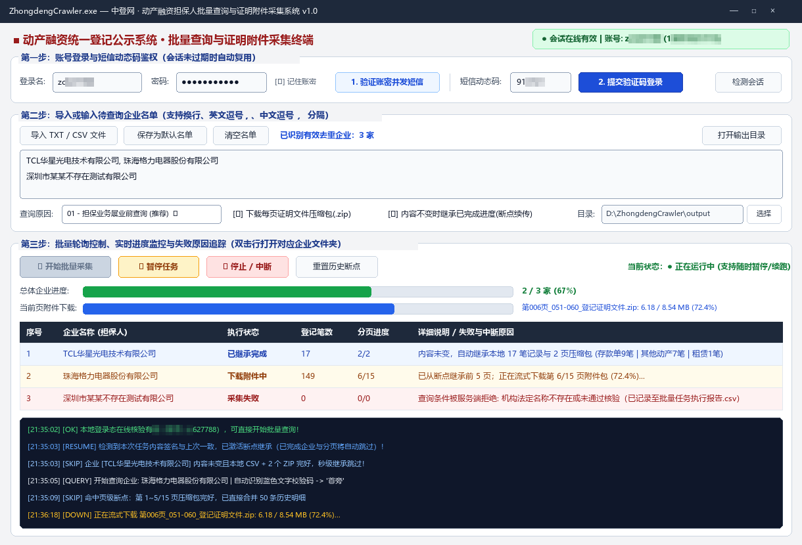
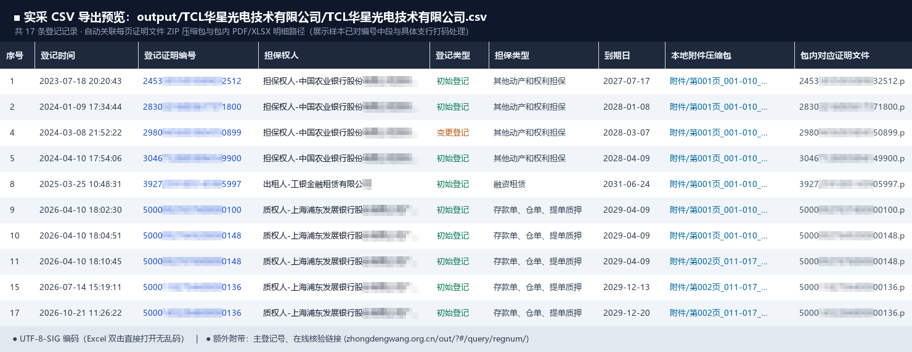
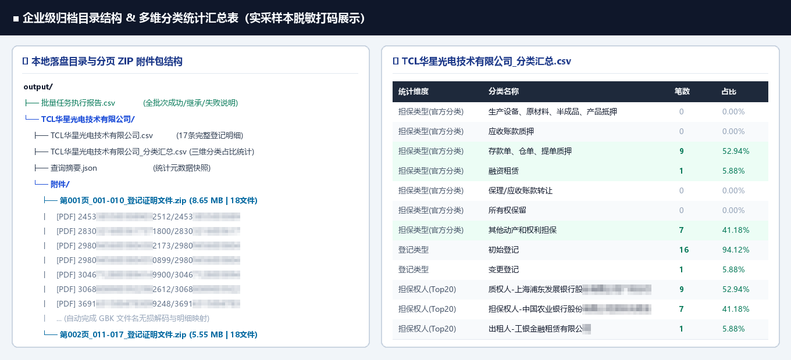
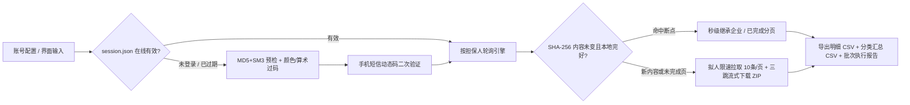

<div align="center">

# 🏛️ Zhongdengwang Crawler (`中登网·动产融资采集系统`)

**纯协议驱动 · 双模式图形码自动识别 · 分页证明附件流式归档 · 断点继承桌面终端**

[](https://www.python.org/)
[](#核心技术亮点)
[](#核心技术亮点)
[](#三桌面端-gui--exe-使用指南)
[](LICENSE)

面向自有合规账号对 **中国人民银行征信中心 · 动产融资统一登记公示系统 (`zhongdengwang.org.cn`)** 进行按担保人批量查询、多维分类统计与每页登记证明文件（`.zip` 内含 `.pdf` / `.xlsx` 等原始附件）自动化归档的工程化工具。支持 **可视化桌面客户端 (`ZhongdengCrawler.exe`)** 与 **命令行 (`CLI`)** 双模式运行。

</div>

---

## ✨ 核心技术亮点

- **⚡ 纯协议零浏览器依赖**：基于 `curl_cffi` 模拟真实 Chrome TLS 指纹直连 REST 接口，无需安装笨重的 Chrome / Selenium / Playwright，单机内存占用极低。
- **🔐 国密双摘要 + 会话自动续期**：完整还原登录密码 `MD5 (32位)` + 国密 `GM/T 0004-2012 SM3 (64位)` 双重摘要校验与手机短信动态码 (`OTP`) 二次鉴权，持久化 `accessToken` 并在每次任务启动前自动在线核验有效性。
- **🧠 双题型验证码自适应识别**：针对中登网随机出现的 **「指定颜色汉字提取」**（如提取蓝字/红字）与 **「加减乘四则算式」** 两类图形校验码，结合 `ddddocr` HSV 颜色通道分离与单数字算式约束实现高准确率自动过码，并提供人工弹窗兜底。
- **📦 三跳流式附件下载与 GBK 解码修复**：打通 `downloadRegInfoPDFOnCurrentPage -> /api/file/download -> /api/file/downloadNew` 三级票据链路，`64KB` 分块流式落盘（`.zip.part` 原子重命名防损毁），自动无损解码服务端 Java `ZipOutputStream` 生成的 `GBK` 中文附件名并与明细行逐一映射。
- **♻️ 暂停 / 中断控制 & 内容不变智能继承**：支持运行途中 **毫秒级暂停、继续、安全中断**；基于输入名单与参数 `SHA-256` 签名校验，**在内容未变前提下自动秒级继承已完成企业及半途中断企业的已完成分页数据与完好压缩包**，绝不重复消耗查询次数。
- **🩺 全链路失败归因报告**：任何校验拦截、网络波动、会话过期均在界面表格与 `output/批量任务执行报告.csv` 中给出清晰可读的中文原因说明。

---

## 📸 实采脱敏效果预览

> 注：以下预览图均由真实采集样本生成，涉及账号、手机号、登记证明编号中段及具体支行名称等敏感信息均已做像素打码脱敏处理。

### 1. 桌面可视化客户端 (`ZhongdengCrawler.exe`)
支持一键检测会话、发短信填动态码登录、多分隔符导入名单、双进度条实时监控、暂停/中断续跑及异常原因追踪：



### 2. 登记明细总表 (`<企业名称>.csv`)
使用 `UTF-8-SIG` 编码导出（Excel 双击直接打开无乱码），自动关联每一条记录对应的分页 `.zip` 压缩包及包内具体 `.pdf` / `.xlsx` 证明文件路径，并附带在线核验入口链接：



### 3. 企业归档目录结构与多维分类汇总 (`<企业名称>_分类汇总.csv`)
按企业自动建立独立文件夹与同级 `附件/` 目录（每 10 条一页保存独立压缩包），同时从 **官方七大担保类型、登记类型（初始/变更/展期）、担保权人 Top20** 三个维度输出占比统计：



---

## 🏗️ 工程架构与协议流程图



### 目录结构说明

```text
zhongdengwang_Crawler/
├── gui_app.py                 # 桌面可视化 GUI 主程序（亦为打包 EXE 入口）
├── main.py                    # CLI 独立登录与会话管理工具
├── query_guarantor.py         # CLI 按担保人批量轮询与分页附件下载入口
├── build_exe.py               # 一键 PyInstaller 打包脚本 (生成 ZhongdengCrawler.exe)
├── requirements.txt           # Python 依赖清单
├── utils/
│   ├── auth.py                # 纯协议登录、短信动态码收发与会话在线核验
│   ├── captcha.py             # 颜色滤镜汉字 + 四则算术验证码自动识别引擎
│   ├── sign.py                # 标准 MD5 与国密 GM/T 0004-2012 SM3 密码摘要
│   ├── guarantor_query.py     # 分页轮询、三跳流式 ZIP 下载、断点继承与暂停控制器
│   └── paths.py               # 源码与 Frozen EXE 统一运行时路径解析
└── config/
    ├── account.example.json   # 账号配置模板（实际 account.json 已被 Git 忽略保护）
    └── targets.example.txt    # 待查询机构名单模板
```

---

## 🚀 快速开始

> 两种使用方式任选其一：
> - **方式 A（零基础 / 只想用）**：下载打包好的 Windows 免安装版，解压双击即用，**无需安装 Python**。
> - **方式 B（开发者 / 源码运行）**：搭建 Python 环境，运行源码或自行打包。

---

### 方式 A：Windows 免安装版（推荐给非技术用户）

1. 获取 `ZhongdengCrawler_Windows_x64.zip`（由维护者通过 `python build_exe.py --zip` 生成，或在仓库 Releases 页面下载）。
2. **右键 → 全部解压缩** 到任意目录（路径可含中文，但**不要在压缩包内直接双击运行**）。
3. 解压后的目录结构如下，**不要把 `ZhongdengCrawler.exe` 单独拖出 `_internal` 所在目录**：
   ```text
   ZhongdengCrawler/
   ├── ZhongdengCrawler.exe   ← 双击运行
   ├── _internal/             ← 运行库（必需，勿删）
   ├── config/                ← 账号、会话、断点（自动生成）
   ├── output/                ← 采集结果
   ├── logs/                  ← 每日运行日志
   └── 使用说明.txt
   ```
4. 双击 `ZhongdengCrawler.exe`，按下文 [「界面操作四步」](#三界面操作四步) 使用即可。

> [!NOTE]
> 首次启动若被 Windows SmartScreen 拦截，点击「更多信息 → 仍要运行」。若杀毒软件误报，请将该目录加入信任（PyInstaller 打包程序常见误报）。

---

### 方式 B：源码运行（开发者）

#### 一、环境要求

| 项目 | 要求 |
| :--- | :--- |
| 操作系统 | Windows 10 / 11 x64（推荐，GUI 与打包针对 Windows 优化）；macOS / Linux 可运行 CLI |
| Python | **3.10 ~ 3.14**（已在 3.14.5 实测通过），安装时勾选 **Add python.exe to PATH** |
| 网络 | 能正常访问 `https://www.zhongdengwang.org.cn` |
| 账号 | 中登网**已注册且绑定手机号**的合法账号（登录需接收短信动态码） |
| 磁盘 | 每家中型企业附件约 5 ~ 30 MB，请预留足够空间 |

验证 Python 安装：
```powershell
python --version   # 应输出 Python 3.10 及以上
pip --version
```

#### 二、获取代码

```powershell
git clone https://github.com/zc627788/zhongdengwang_Crawler.git
cd zhongdengwang_Crawler
```
（没有 Git 可在 GitHub 页面点击 **Code → Download ZIP** 后解压。）

#### 三、创建虚拟环境并安装依赖（推荐）

**Windows PowerShell：**
```powershell
python -m venv .venv
.\.venv\Scripts\Activate.ps1
# 若提示"禁止运行脚本"，先执行：Set-ExecutionPolicy -Scope CurrentUser RemoteSigned
python -m pip install --upgrade pip
pip install -r requirements.txt
```

**Windows CMD：**
```bat
python -m venv .venv
.venv\Scripts\activate.bat
pip install -r requirements.txt
```

**macOS / Linux：**
```bash
python3 -m venv .venv
source .venv/bin/activate
pip install -r requirements.txt
```

> [!TIP]
> 国内网络安装慢可使用清华镜像：
> `pip install -r requirements.txt -i https://pypi.tuna.tsinghua.edu.cn/simple`

依赖说明（`requirements.txt`）：

| 包 | 作用 |
| :--- | :--- |
| `curl_cffi` | 模拟 Chrome TLS 指纹的 HTTP 客户端（核心协议引擎） |
| `ddddocr` | 图形验证码 OCR（会自动安装 `onnxruntime`、`numpy`、`opencv-python`） |
| `cryptography` | 密码摘要相关加密支持 |
| `Pillow` | 验证码图片预处理与 GUI 显示 |

`tkinter` 为 Python 自带 GUI 库（Windows / macOS 官方安装包已内置；Linux 需 `sudo apt install python3-tk`）。

#### 四、环境自检（可选但推荐）

```powershell
python gui_app.py --self-test
```
输出 JSON 中 `"ok": true` 且 `"live_captcha_verified": true` 即表示依赖、OCR 模型与网络均正常。

---

### 三、界面操作四步

启动桌面端：
```powershell
python gui_app.py          # 源码方式
# 或双击 ZhongdengCrawler.exe（免安装方式）
```

1. **登录鉴权**
   - 输入中登网登录名与密码，可勾选「记住账密」（保存在本地 `config/account.json`，不会上传）。
   - 点击 **「1. 验证账密并发短信」**：程序自动识别图形验证码并校验账密，成功后向绑定手机发送短信。
   - 填入 6 位短信动态码 → 点击 **「2. 提交验证码登录」**。
   - 登录态保存在 `config/session.json`，有效期内重开软件**免重复登录**；右上角绿色徽标显示「会话在线有效」。
2. **导入企业名单**
   - 文本框直接粘贴企业**法定全称**，支持换行、英文逗号 `,`、中文逗号 `，`、分号分隔，自动去重。
   - 或点击「导入 TXT / CSV 文件」。可点「保存为默认名单」下次自动载入。
3. **设置参数并开始**
   - 查询原因：默认 `01`（担保业务尽职调查），按实际业务选择。
   - 「下载每页证明文件压缩包 (.zip)」：勾选则下载 PDF 附件（慢，受服务端限速）；不勾选仅导出 CSV（快）。
   - 「内容不变时继承已完成进度」：建议保持勾选。
   - 点击 **「▶ 开始批量采集」**。
4. **监控、暂停与续跑**
   - 表格实时显示每家企业状态、笔数、分页进度及失败原因；双击某行打开该企业输出目录。
   - 随时可「暂停任务」/「停止 / 中断」。**名单内容不变时再次开始，会自动跳过已完成企业与已下载分页**，从断点继续。

---

### 四、命令行（CLI）模式

适合服务器 / 计划任务挂机。

1. **配置账号**
   ```powershell
   copy config\account.example.json config\account.json
   # 编辑 config/account.json，填入 username / password
   ```
2. **登录（交互式，按提示输入短信码）**
   ```powershell
   python main.py
   ```
   非交互分两步：
   ```powershell
   python main.py --send-only      # 过图形码并发送短信
   python main.py --code 123456    # 提交短信动态码
   ```
   其它参数：`--force` 忽略已有会话强制重新登录。
3. **批量采集**
   ```powershell
   # 直接传入企业名单
   python query_guarantor.py --targets "TCL华星光电技术有限公司,武汉华星光电技术有限公司"

   # 从文件读取（默认 config/targets.txt，可参考 config/targets.example.txt）
   python query_guarantor.py --file config/targets.txt

   # 仅导出 CSV，不下载附件 ZIP
   python query_guarantor.py --file config/targets.txt --no-download

   # 忽略断点，强制全量重采
   python query_guarantor.py --file config/targets.txt --force
   ```

| 参数 | 说明 |
| :--- | :--- |
| `--targets` | 企业名称列表（逗号 / 换行分隔） |
| `--file` | 名单文件路径（`.txt` / `.csv`），默认 `config/targets.txt` |
| `--output` | 输出根目录，默认 `./output` |
| `--reason` | 查询原因编码，默认 `01` |
| `--no-download` | 不下载每页附件压缩包 |
| `--force` | 忽略断点缓存强制重采 |
| `--code` | 传入短信动态码完成登录后立即开始采集 |
| `--auto-send-sms` | 非交互模式下会话过期时自动发短信后退出，等待 `--code` |

---

### 五、输出文件说明

```text
output/
├── 批量任务执行报告.csv                     # 全批次成功 / 继承 / 失败原因汇总
└── <企业名称>/
    ├── <企业名称>.csv                        # 登记明细总表（UTF-8-SIG，Excel 直接打开）
    ├── <企业名称>_分类汇总.csv               # 担保类型 / 登记类型 / 担保权人 Top20 占比
    ├── 查询摘要.json                         # 查询流水号、总笔数、页数等元数据
    └── 附件/
        ├── 第001页_001-010_登记证明文件.zip  # 每 10 条一个压缩包，含原始 PDF / XLSX
        └── 第002页_011-017_登记证明文件.zip
logs/
└── zhongdeng_YYYYMMDD.log                    # 每日完整运行日志（含底层网络异常详情）
```

---

### 六、一键打包 Windows `.exe` / 免安装 `.zip`

```powershell
pip install pyinstaller

python build_exe.py              # 仅编译 dist/ZhongdengCrawler/ZhongdengCrawler.exe（默认不生成 zip）
python build_exe.py --zip        # 编译并生成 dist/ZhongdengCrawler_Windows_x64.zip
python build_exe.py --zip-only   # 跳过编译，仅清理并重新压缩现有 dist 目录
python build_exe.py --onefile    # 单文件版（启动较慢）
```

构建脚本会自动：清空 `config/`、`output/`、`logs/`，写入空白 `account.json` 与 `使用说明.txt`，**确保分发包不含构建者的账号、会话或采集数据**。编译约 1 分钟，压缩包约 160 MB。

打包后自检：
```powershell
dist\ZhongdengCrawler\ZhongdengCrawler.exe --self-test
```

---

## ⏱️ 性能参考（实测）

以 6 家企业（共 179 笔登记、21 页附件、约 84 MB）全量实测，成功率 **6/6**，总耗时约 30 分钟。

| 场景 | 单家耗时 | 单机单日（24h）约 |
| :--- | :--- | :--- |
| 类似 TCL 华星（17 笔 / 2 页 / 14 MB），下载附件 | 2.5 ~ 3 分钟 | 480 ~ 550 家 |
| 1 页小企业或 0 笔企业，下载附件 | 15 ~ 40 秒 | 800 ~ 1200 家 |
| 仅导出 CSV（`--no-download`） | 15 ~ 20 秒 | 理论 2000+ 家 |

瓶颈在中登网附件接口的**服务端限速（约 80 ~ 180 KB/s）**，非本机性能。出于账号安全，建议**单账号每日 200 ~ 350 家**以内分批运行。

---

## ❓ 常见问题（FAQ）

<details>
<summary><b>日志出现 <code>curl: (56) Connection closed abruptly</code> 或 <code>curl: (35) TLS connect error</code></b></summary>

中登网网关在大文件传输前后偶发主动重置连接，属正常网络现象。程序会自动重建连接池并重试（下载最多 6 次，普通接口 3 次），界面显示 `🔄 [下载重连 x/6]`，无需人工干预。若连续 6 次失败，检查本机网络 / 代理后重新开始，已完成分页会自动继承。
</details>

<details>
<summary><b>图形验证码一直识别失败</b></summary>

程序会自动换图重试；查询验证码连续 12 次未通过后会弹出人工输入窗口，照图输入即可。若 OCR 完全不可用，执行 `python gui_app.py --self-test` 检查 `ddddocr` / `onnxruntime` 是否安装正常。
</details>

<details>
<summary><b>提示「访问无效,请重新登录」/ 403</b></summary>

登录会话已过期。重新发送短信登录后再次点击「开始批量采集」，进度会自动从断点继续。
</details>

<details>
<summary><b><code>pip install</code> 失败 / <code>onnxruntime</code> 安装报错</b></summary>

升级 pip（`python -m pip install --upgrade pip`），并确认使用 **64 位** Python。Windows 若报缺少 DLL，安装 [Microsoft Visual C++ 运行库](https://aka.ms/vs/17/release/vc_redist.x64.exe)。
</details>

<details>
<summary><b>PowerShell 无法激活虚拟环境</b></summary>

执行 `Set-ExecutionPolicy -Scope CurrentUser RemoteSigned` 后重试，或改用 CMD 下的 `.venv\Scripts\activate.bat`。
</details>

<details>
<summary><b>如何排查失败原因？</b></summary>

1. 看界面表格「详细说明 / 失败与中断原因」列；
2. 看 `output/批量任务执行报告.csv`；
3. 看 `logs/zhongdeng_YYYYMMDD.log`（含 `[DETAIL]` 底层异常信息），提 Issue 时请附上相关日志片段（注意先删除账号等隐私信息）。
</details>

---

## 🛡️ 合规与免责声明

1. 本项目仅面向拥有 **中登网合法注册账号** 的用户提供自有业务查询效率辅助与数据整理归档能力，严禁用于任何未经授权的数据抓取、商业倒卖或非法用途。
2. 程序内置人工浏览节奏模拟（翻页、点击下载、企业切换之间均有随机停顿，每满 10 页阶段性休息 `12s ~ 18s`），请勿删改限速逻辑以免对公共服务造成负担。
3. 仓库已通过 `.gitignore` 排除 `config/account.json`、`config/session.json`、`output/`、`logs/` 等目录，请妥善保管个人凭据与查询结果，遵守《个人信息保护法》《数据安全法》及平台服务协议。
