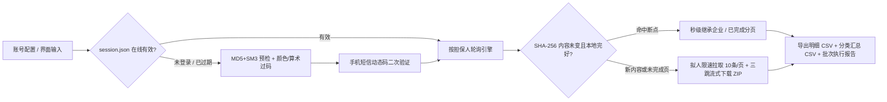

<div align="center">

# 🏛️ Zhongdengwang Crawler (`中登网·动产融资采集系统`)

**纯协议驱动 · 双模式图形码自动识别 · 分页证明附件流式归档 · 断点继承桌面终端**

[](https://www.python.org/)
[](#核心技术亮点)
[](#核心技术亮点)
[](#三桌面端-gui--exe-使用指南)
[](LICENSE)

面向自有合规账号对 **中国人民银行征信中心 · 动产融资统一登记公示系统 (`zhongdengwang.org.cn`)** 进行按担保人批量查询、多维分类统计与每页登记证明文件（`.zip` 内含 `.pdf` / `.xlsx` 等原始附件）自动化归档的工程化工具。支持 **可视化桌面客户端 (`ZhongdengCrawler.exe`)** 与 **命令行 (`CLI`)** 双模式运行。

</div>

---

## ✨ 核心技术亮点

- **⚡ 纯协议零浏览器依赖**：基于 `curl_cffi` 模拟真实 Chrome TLS 指纹直连 REST 接口，无需安装笨重的 Chrome / Selenium / Playwright，单机内存占用极低。
- **🔐 国密双摘要 + 会话自动续期**：完整还原登录密码 `MD5 (32位)` + 国密 `GM/T 0004-2012 SM3 (64位)` 双重摘要校验与手机短信动态码 (`OTP`) 二次鉴权，持久化 `accessToken` 并在每次任务启动前自动在线核验有效性。
- **🧠 双题型验证码自适应识别**：针对中登网随机出现的 **「指定颜色汉字提取」**（如提取蓝字/红字）与 **「加减乘四则算式」** 两类图形校验码，结合 `ddddocr` HSV 颜色通道分离与单数字算式约束实现高准确率自动过码，并提供人工弹窗兜底。
- **📦 三跳流式附件下载与 GBK 解码修复**：打通 `downloadRegInfoPDFOnCurrentPage -> /api/file/download -> /api/file/downloadNew` 三级票据链路，`64KB` 分块流式落盘（`.zip.part` 原子重命名防损毁），自动无损解码服务端 Java `ZipOutputStream` 生成的 `GBK` 中文附件名并与明细行逐一映射。
- **♻️ 暂停 / 中断控制 & 内容不变智能继承**：支持运行途中 **毫秒级暂停、继续、安全中断**；基于输入名单与参数 `SHA-256` 签名校验，**在内容未变前提下自动秒级继承已完成企业及半途中断企业的已完成分页数据与完好压缩包**，绝不重复消耗查询次数。
- **🩺 全链路失败归因报告**：任何校验拦截、网络波动、会话过期均在界面表格与 `output/批量任务执行报告.csv` 中给出清晰可读的中文原因说明。

---

## 📸 实采脱敏效果预览

> 注：以下预览图均由真实采集样本生成，涉及账号、手机号、登记证明编号中段及具体支行名称等敏感信息均已做像素打码脱敏处理。

### 1. 桌面可视化客户端 (`ZhongdengCrawler.exe`)
支持一键检测会话、发短信填动态码登录、多分隔符导入名单、双进度条实时监控、暂停/中断续跑及异常原因追踪：


### 2. 登记明细总表 (`<企业名称>.csv`)
使用 `UTF-8-SIG` 编码导出（Excel 双击直接打开无乱码），自动关联每一条记录对应的分页 `.zip` 压缩包及包内具体 `.pdf` / `.xlsx` 证明文件路径，并附带在线核验入口链接：


### 3. 企业归档目录结构与多维分类汇总 (`<企业名称>_分类汇总.csv`)
按企业自动建立独立文件夹与同级 `附件/` 目录（每 10 条一页保存独立压缩包），同时从 **官方七大担保类型、登记类型（初始/变更/展期）、担保权人 Top20** 三个维度输出占比统计：


---

## 🏗️ 工程架构与协议流程图



### 目录结构说明

```text
zhongdengwang_Crawler/
├── gui_app.py                 # 桌面可视化 GUI 主程序（亦为打包 EXE 入口）
├── main.py                    # CLI 独立登录与会话管理工具
├── query_guarantor.py         # CLI 按担保人批量轮询与分页附件下载入口
├── build_exe.py               # 一键 PyInstaller 打包脚本 (生成 ZhongdengCrawler.exe)
├── requirements.txt           # Python 依赖清单
├── utils/
│   ├── auth.py                # 纯协议登录、短信动态码收发与会话在线核验
│   ├── captcha.py             # 颜色滤镜汉字 + 四则算术验证码自动识别引擎
│   ├── sign.py                # 标准 MD5 与国密 GM/T 0004-2012 SM3 密码摘要
│   ├── guarantor_query.py     # 分页轮询、三跳流式 ZIP 下载、断点继承与暂停控制器
│   └── paths.py               # 源码与 Frozen EXE 统一运行时路径解析
└── config/
    ├── account.example.json   # 账号配置模板（实际 account.json 已被 Git 忽略保护）
    └── targets.example.txt    # 待查询机构名单模板
```

---

## 🚀 快速开始

### 一、环境安装（源码运行）

推荐使用 **Python 3.10 ~ 3.14**（Windows / macOS / Linux 均可运行核心协议，桌面端打包针对 Windows 优化）：

```bash
git clone https://github.com/zc627788/zhongdengwang_Crawler.git
cd zhongdengwang_Crawler
pip install -r requirements.txt
```

### 二、启动桌面可视化界面（推荐）

直接运行桌面端入口：

```bash
python gui_app.py
```

**界面四步闭环操作：**
1. **登录鉴权**：若右上角提示未登录或已过期，输入中登网账号密码 -> 点击 **「1. 验证账密并发短信」** -> 输入手机收到的 6 位短信动态码 -> 点击 **「2. 提交验证码登录」**（登录态自动保存至 `config/session.json`，有效期内重开软件免重复登录）。
2. **输入或导入企业名单**：在文本框中直接粘贴企业法定全称（支持 **一行一个、英文逗号 `,` 或中文逗号 `，` 分隔**），或点击 **「导入 TXT / CSV 文件」** 一键载入。
3. **运行与过程控制**：点击 **「▶ 开始批量采集」**。运行中可随时点击 **「⏸ 暂停任务」**、**「▶ 继续运行」** 或 **「⏹ 停止 / 中断」**。
4. **断点自动继承**：若任务中途暂停、断网或主动中断，**只要不修改待查名单内容，再次点击「开始批量采集」将自动秒级跳过已完成企业及已下载完的分页压缩包**，无缝从断点页续跑！双击表格任意行可直接打开该企业的本地输出文件夹。

### 三、命令行 (`CLI`) 批量模式

1. **配置账号**：将 `config/account.example.json` 复制为 `config/account.json` 并填入账号密码。
2. **登录获取会话**：
   ```bash
   python main.py
   ```
3. **批量轮询采集**：
   ```bash
   # 方式 A：直接传入逗号分隔的企业名称
   python query_guarantor.py --targets "TCL华星光电技术有限公司,珠海格力电器股份有限公司"

   # 方式 B：指定本地 TXT 或 CSV 名单文件
   python query_guarantor.py --file config/targets.txt

   # 方式 C：忽略历史断点缓存，强制全量重采
   python query_guarantor.py --file config/targets.txt --force
   ```

### 四、一键打包独立 Windows `.exe`

如需在无 Python 环境的 Windows 电脑上分发使用，安装 `pyinstaller` 后执行内置构建脚本：

```bash
pip install pyinstaller
python build_exe.py
```

打包完成后直接运行 `dist/ZhongdengCrawler/ZhongdengCrawler.exe` 即可（`config/` 与 `output/` 会自动生成在 `.exe` 同级目录，确保登录会话与任务断点跨重启持久保留）。

---

## 🛡️ 合规与免责声明

1. 本项目仅面向拥有 **中登网合法注册账号** 的用户提供自有业务查询效率辅助与数据整理归档能力，严禁用于任何未经授权的数据抓取、商业倒卖或非法用途。
2. 程序内置严格的人工浏览节奏模拟（每页随机停顿 `2.5s ~ 5.5s`、每满 10 页阶段性休息 `12s ~ 18s`、企业切换随机停顿 `6s ~ 11s`），请勿删改限速逻辑以免对公共服务造成负担。
3. 仓库已通过 `.gitignore` 严格排除 `config/account.json`、`config/session.json` 及 `output/` 数据目录，请妥善保管个人凭据与查询结果，遵守《个人信息保护法》《数据安全法》及平台服务协议。
